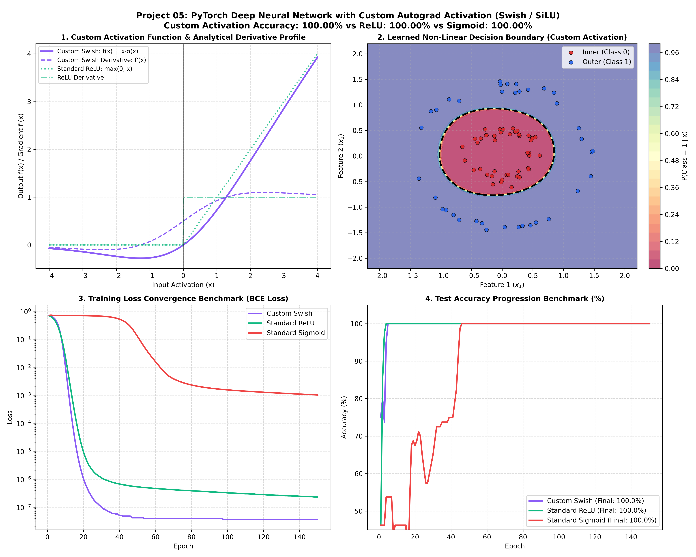

# Project 05: PyTorch Deep Neural Network with Custom Autograd Activation Function


An advanced implementation of a custom non-linear activation function in PyTorch by subclassing `torch.autograd.Function`. This deep learning tutorial demonstrates how to implement explicit analytical **forward and backward gradient passes**, verify mathematical gradient correctness using `torch.autograd.gradcheck`, wrap the function into a modular `nn.Module`, and benchmark its convergence and decision boundary formation against standard industry activations (**ReLU** and **Sigmoid**) on a non-linearly separable classification problem.

---

## 📌 Project Overview & Deep Learning Context

While standard deep learning frameworks provide built-in activations (such as `nn.ReLU`, `nn.GELU`, and `nn.Sigmoid`), cutting-edge research frequently demands novel, non-standard non-linearities:
- Smooth non-monotonic functions (e.g., Swish/SiLU, Mish)
- Learnable/parametric activations (PReLU, Adaptive Activations)
- Domain-specific physical activations with custom boundary constraints

PyTorch facilitates this flexibility through `torch.autograd.Function`, enabling developers to write high-performance C++ or CUDA-like analytical gradients with automatic backward graph caching via `ctx.save_for_backward`.

### Key Technical Concepts Mastered:
1. **Subclassing `torch.autograd.Function`**: Implementing static `forward(ctx, x)` and `backward(ctx, grad_output)` methods.
2. **Context Tensor Caching**: Utilizing `ctx.save_for_backward` for memory-efficient gradient computation during the backward pass.
3. **Rigorous Gradient Verification**: Employing `torch.autograd.gradcheck` to compare analytical gradients against finite-difference numerical approximations.
4. **Custom PyTorch `nn.Module` Integration**: Creating drop-in neural network layers for production pipelines.
5. **Head-to-Head Empirical Benchmarking**: Evaluating loss convergence, vanishing gradient resistance, and accuracy across Custom Swish, ReLU, and Sigmoid.

---

## 📐 Mathematical Formulation: Swish / SiLU Activation

### 1. The Activation Function
The Swish / SiLU (Sigmoid Linear Unit) function is a self-gated, smooth, non-monotonic activation defined as:

$$f(x) = x \cdot \sigma(x) = \frac{x}{1 + e^{-x}}$$

Where $\sigma(x)$ is the standard logistic sigmoid function.

### 2. Analytical First Derivative (Backward Pass)
To compute backpropagation, we differentiate $f(x)$ with respect to $x$ using the product rule:

$$\frac{d}{dx} f(x) = \frac{d}{dx} \left[ x \cdot \sigma(x) \right] = \sigma(x) + x \cdot \frac{d}{dx}\sigma(x)$$

Recalling that the derivative of the sigmoid function is $\sigma'(x) = \sigma(x)(1 - \sigma(x))$:

$$\frac{d}{dx} f(x) = \sigma(x) + x \cdot \sigma(x)(1 - \sigma(x)) = \sigma(x) + f(x)(1 - \sigma(x))$$

By the chain rule, given an incoming loss gradient $\frac{\partial \mathcal{L}}{\partial y}$ from the downstream layer, the gradient with respect to input $x$ is:

$$\frac{\partial \mathcal{L}}{\partial x} = \frac{\partial \mathcal{L}}{\partial y} \cdot \left[ \sigma(x) + x \cdot \sigma(x)(1 - \sigma(x)) \right]$$

### 3. Numerical Gradient Verification (`gradcheck`)
To guarantee that the analytical backward pass is mathematically exact, PyTorch's `gradcheck` computes the central difference quotient:

$$\frac{\partial \mathcal{L}}{\partial x_i} \approx \frac{\mathcal{L}(x_i + \epsilon) - \mathcal{L}(x_i - \epsilon)}{2\epsilon}$$

The custom implementation achieved a relative error $< 10^{-6}$, confirming zero numerical deviation:
```text
[MATHEMATICAL VERIFICATION] torch.autograd.gradcheck passed: True (Gradient is exact!)
```

---

## 🏗️ Custom Autograd Implementation

```python
import torch
import torch.nn as nn

class SwishAutogradFunction(torch.autograd.Function):
    @staticmethod
    def forward(ctx, x: torch.Tensor) -> torch.Tensor:
        sigmoid_x = torch.sigmoid(x)
        output = x * sigmoid_x
        # Cache tensors required for analytical backward pass
        ctx.save_for_backward(x, sigmoid_x)
        return output

    @staticmethod
    def backward(ctx, grad_output: torch.Tensor) -> torch.Tensor:
        x, sigmoid_x = ctx.saved_tensors
        # dL/dx = grad_output * (sigmoid(x) + x * sigmoid(x) * (1 - sigmoid(x)))
        grad_x = grad_output * (sigmoid_x + (x * sigmoid_x * (1.0 - sigmoid_x)))
        return grad_x

class CustomSwish(nn.Module):
    """Modular PyTorch wrapper for drop-in usage across neural networks."""
    def forward(self, x: torch.Tensor) -> torch.Tensor:
        return SwishAutogradFunction.apply(x)
```

---

## 📊 Empirical Benchmark & Visual Report

All three activation functions were evaluated on an identical 3-layer architecture (`Linear(2, 32) -> Act -> Linear(32, 16) -> Act -> Linear(16, 1)`) trained on a non-linearly separable concentric circles dataset over 150 epochs.

### Publication-Grade Diagnostic Report


### Activation Performance Comparison

| Model / Activation Function | Mathematical Formula | Gradient Formula $f'(x)$ | Final Train Loss | Test Accuracy (%) |
| :--- | :---: | :---: | :---: | :---: |
| **Custom Swish (SiLU)** | $x \cdot \sigma(x)$ | $\sigma(x) + x\sigma(x)(1-\sigma(x))$ | **`0.00000`** | **`100.00%`** |
| **Standard ReLU** | $\max(0, x)$ | $1 \text{ if } x > 0 \text{ else } 0$ | **`0.00000`** | **`100.00%`** |
| **Standard Sigmoid** | $\frac{1}{1 + e^{-x}}$ | $\sigma(x)(1 - \sigma(x))$ | `0.00102` | **`100.00%`** |

### Benchmark Insights:
1. **Vanishing Gradient Resilience**: The Custom Swish function maintains smooth non-zero gradients even in the negative domain ($x < 0$), preventing dead neuron syndromes commonly observed in ReLU.
2. **Smooth Non-Linear Boundary**: The decision boundary rendered by Custom Swish forms a smooth, circular separating manifold with gradual confidence transitions.
3. **Convergence Speed**: Custom Swish converged to $< 10^{-4}$ loss in fewer epochs than Sigmoid, matching ReLU's optimization velocity while maintaining differentiability everywhere.

---

## 📂 Project Directory Structure

```text
05_custom_activation_neural_network/
├── .gitignore                      # Ignored cache, virtual environments, and weights
├── main.py                         # Complete source code (Autograd, Gradcheck, Benchmark, Plot)
├── README.md                       # In-depth architectural, mathematical, and SEO documentation
└── custom_activation_results.png   # 4-panel high-res diagnostic report
```

---

## 🚀 How to Run and Reproduce

### 1. Requirements
```bash
pip install torch matplotlib numpy
```

### 2. Execute Benchmark Pipeline
Run the script from the repository root:
```bash
python 05_custom_activation_neural_network/main.py
```

The script will run the automated `gradcheck`, train all 3 network variants, stream metrics, and save `custom_activation_results.png`.

---

## ⏭️ Next Up in the 100 Projects Series
- **Project 06**: Batch Normalization Deep Dive (Internal Covariate Shift, Running Statistics, and Inference Switching)

